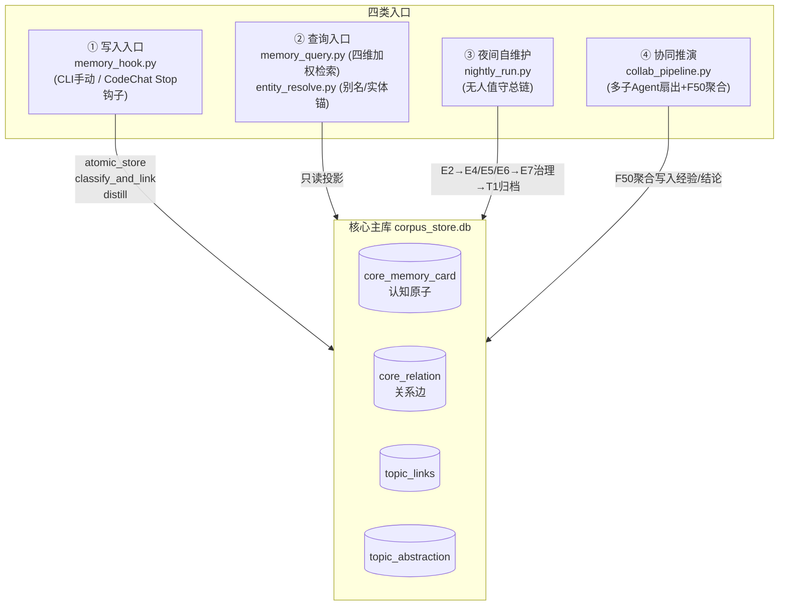
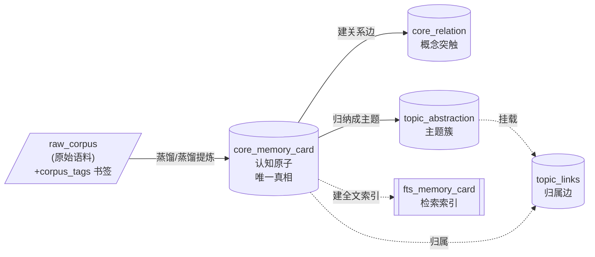
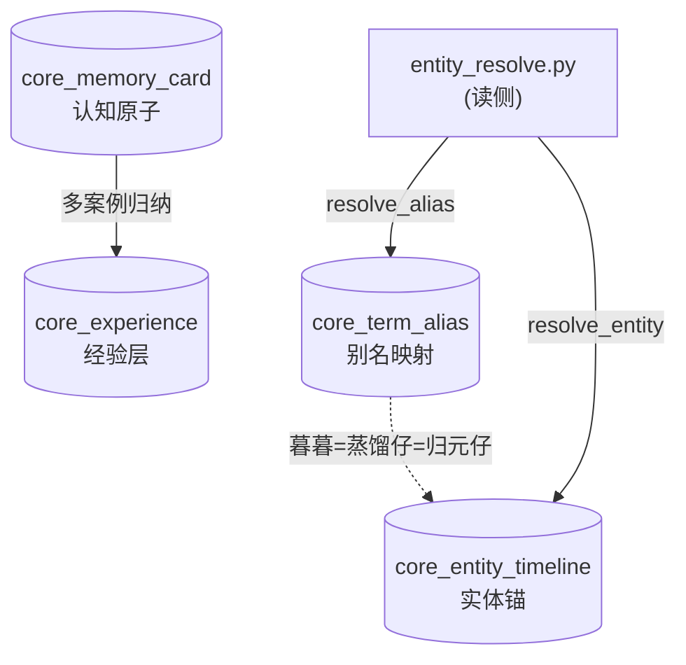
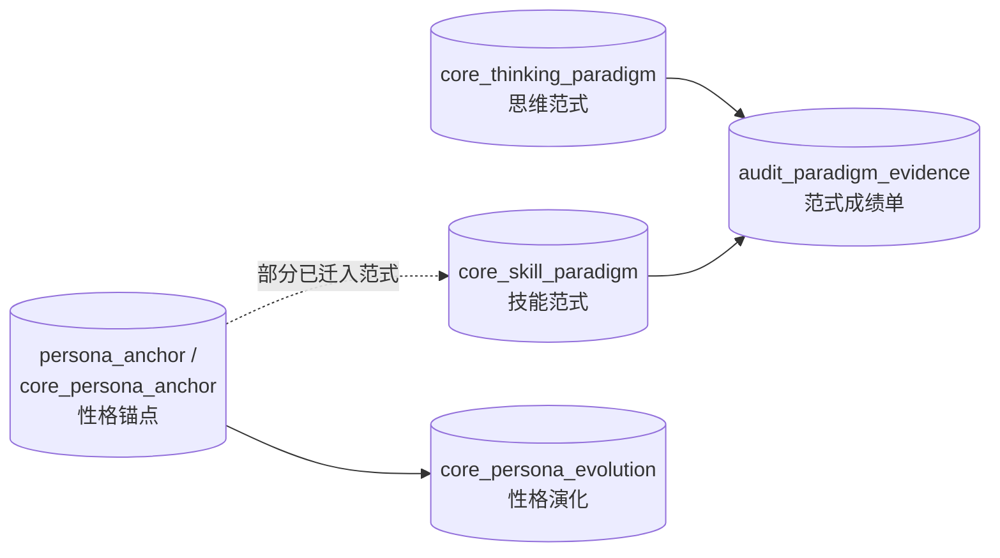
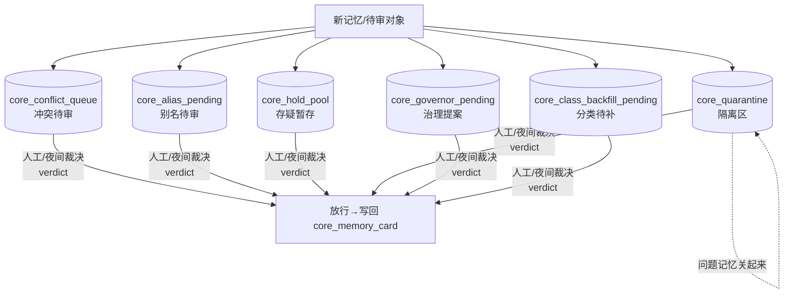
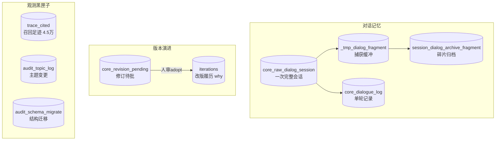
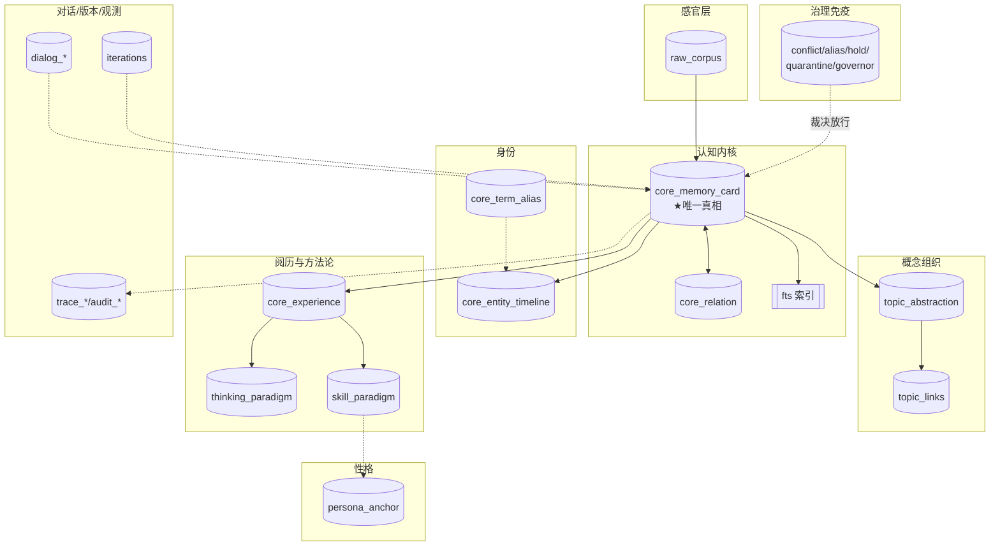

# 记忆系统表关系图 + 入口说明

> 读者：未来会话的我 / 任何要理解这套系统的人。
> 配套：`db_table_registry.md`（逐表定性台账）——本文讲**关系与流程**，台账讲**单表死活**。
> 快照：2026-11-25

---

## 一、入口总览（谁在使用这套系统）

四类入口，性质完全不同：

| 入口 | 文件 | 干什么 | 触发方式 |
|---|---|---|---|
| **① 写入** | `memory/memory_hook.py` | 采集会话中的裁决/纠错/洞察，走 `atomic_store→classify_and_link→distill` 三管道 | CLI 手动 `add` / CodeChat Stop 钩子 `session` |
| **② 查询** | `memory/memory_query.py` | 四维加权检索投影（编码0.3+置信0.25+调用0.25+关联0.2） | 只读，被上层调用 |
| | `memory/entity_resolve.py` | 别名归并 + 实体锚查找（#49 阶段2） | `python entity_resolve.py <名字>` |
| **③ 夜间** | `scripts/nightly_run.py` | E2分钟级→E4/E5/E6→E7治理→T1归档，全程无人值守 | 定时 `NO_MEMORY=1 python scripts/nightly_run.py` |
| **④ 推演** | `scripts/collab_pipeline.py` | N路独立子Agent各跑run_atomic，F50聚合抽象指标 | 按需手动 |

---

## 二、记忆形成链（数据自下而上蒸馏）

**概念**：原文（raw）→ 蒸馏成认知原子（memory_card，这是**唯一真相**）→ 原子之间连关系（relation）、归到主题（topic）。

---

## 三、身份与经验层（"这是谁、我学到了什么"）

**概念**：`entity_timeline` 回答"这个名字指的是哪个真实对象"，`term_alias` 回答"同一对象的多个叫法"，`experience` 回答"我从多个案例里学到了什么"（复盘/定案/踩坑）。

---

## 四、方法论与性格层

**概念**：思维范式（怎么推）+ 技能范式（怎么做）+ 性格锚点（我是谁/底线）；`evidence` 记录哪条范式真管用。

---

## 五、免疫系统（记忆治理，防污染）

**概念**：任何"不干净/不确定"的记忆先进对应队列（`verdict IS NULL`=待审），裁决后放行或隔离。这是防止脏数据污染主库的免疫层。

---

## 六、对话记忆 + 版本 + 观测

**概念**：对话过程本身被记忆（会话→碎片→单轮）；每次改版留`why`（iterations）；每次运行留足迹（trace/audit），供回归和对账。

---

## 七、全局关系总图（一张看全）

**读法**：
- 实线 = 数据流向（raw→card→relation/topic/entity/experience→paradigm）
- 虚线 = 弱关联/归档/追溯
- ★ `core_memory_card` 是全系统的中心，一切都围绕它
- 治理层（Q）不在主链上，是"旁路的质检站"，裁决后才放行进主库

---

## 八、关键提醒

1. **中心是 `core_memory_card`**，其余表要么喂它（raw/dialog）、要么从它派生（relation/topic/experience）、要么管它（治理队列）。
2. **入口只有四类**，日常自动跑的是 ③ night/y_run；人工干预走 ① hook 写入和 ② query 读取。
3. **`core_` 前缀不代表活**（见台账）：`raw_corpus`/`topic_links` 无前缀才是活的。
4. **图是概念图**，省略了字段级细节和 FTS/归档等辅助表，完整清单看 `db_table_registry.md`。