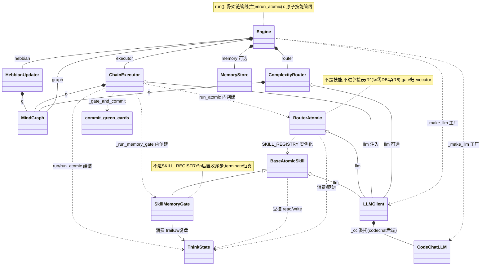

# 02 cgraph 核心类图

> 生成日期：2026-11-25 18:05
> 覆盖：13 个文件（executor/graph/engine/router/router_atomic/atomic_skill/green_card_writer/skill_memory_gate/hebbian/trajectory/memory/llm/llm_codechat），共 17 个类/结构体（含 dataclass）。
> 模块定性：**元核运行时 / 调度大脑**。cgraph 是认知引擎 v3 的推理执行核——"Python 薄壳 + Prompt 内核"范式，Python 侧承载全部刚性约束（权限/schema/菜单/终止/审计），LLM 只做语义工作。注意：范式表（DB）与此运行时（mind_graph.json / atomic_skills_adjacency.json）是两套数据源，E7 架构缺口调研已确认二者断连。

## 一、类总览表

| 类名 | 文件 | 行数 | 职责一句话 | 继承自 | 关键方法 | 被谁实例化 |
|---|---|---|---|---|---|---|
| WalkResult | executor.py | 36-47 | 走链全量结果载体（dataclass） | — | — | ChainExecutor.run 构造 |
| ChainExecutor | executor.py | 50-541 | 走链执行器：按 RouteDecision 分阶段驱动 LLM；两条管线（骨架 run / 原子 run_atomic） | — | run, run_atomic, _walk_chain, _run_memory_gate | Engine；scripts/parallel_pipeline、collab_pipeline、各探针脚本 |
| SkeletonNode | graph.py | 34-48 | 骨架节点定义（dataclass） | — | to_prompt_line | MindGraph 构建 |
| EdgeWeight | graph.py | 51-58 | 边权+成败计数（dataclass） | — | to_dict | MindGraph |
| MindGraph | graph.py | 61-202 | 思维有向图：27 骨架转译带权图，自实现不依赖 networkx | — | from_mapping, load, save, neighbors, reachable_subgraph, reinforce_path, global_decay | Engine（load）；TrajectoryAssembler；scripts/build_graph |
| Engine | engine.py | 20-149 | 单轮对话全流程入口：路由→执行→验证→赫布→记忆归档 | — | run, _make_llm, _log_route | 各 scripts、eval/experiment 多处 `Engine()` |
| RouteDecision | router.py | 19-29 | 路由决策（dataclass），is_valid 校验保底三条 | — | is_valid | ComplexityRouter |
| ComplexityRouter | router.py | 32-153 | 三档复杂度路由：LLM 语义判档+图贪心主路径 | — | route, _classify_llm, _greedy_path, _ensure_mandatory | Engine |
| RouteReport | router_atomic.py | 90-100 | 原子路由报告（dataclass，四通道退出） | — | — | RouterAtomic |
| RouterAtomic | router_atomic.py | 103-381 | 原子技能编排层调度循环（R1-R12 红线；非原子技能） | — | run, _run_inner, _route_llm, _clean_menu, _validate, _c3_should_preempt, _exec_skill | ChainExecutor.run_atomic；test_skill_router |
| ThinkState | atomic_skill.py | 44-96 | 单次思考任务的内存态（dataclass，不落盘） | — | read, write | executor/RouterAtomic/全部技能 |
| BaseAtomicSkill | atomic_skill.py | 155-264 | 原子技能基类：run 五步生命周期（权限→prompt→chat→schema→写回） | — | run, build_prompt*, parse_result*, decide_terminate, _in, _degraded | SKILL_REGISTRY 各技能子类 |
| SkillResult | atomic_skill.py | 267-275 | 技能统一输出（dataclass） | — | — | 基类 run 返回 |
| SkillMemoryGate | skill_memory_gate.py | 117-213 | 记忆写入闸门：绿/黄/红分档立卡判定（只判定不执行） | BaseAtomicSkill | build_prompt, parse_result, decide_terminate, run(断言出口) | executor._run_memory_gate（不进 SKILL_REGISTRY，非链上技能） |
| WalkFeedback | hebbian.py | 34-42 | 反馈信号（dataclass：path+verify_ratio+utility） | — | to_dict | Engine.run 构造 |
| HebbianUpdater | hebbian.py | 45-95 | 边权累加-衰减计数器（非赫布/非图学习，命名沿用历史） | — | apply, path_win_rates | Engine；scripts/smoke_test |
| TrajectorySample | trajectory.py | 31-55 | DPO 训练样本（dataclass，含质量闸门） | — | passes_gate, to_train_row | TrajectoryAssembler |
| TrajectoryAssembler | trajectory.py | 58-99 | WalkResult→DPO 轨迹组装器 | — | assemble | scripts/collect_trajectories |
| MemoryStore | memory.py | 15-71 | ChromaDB 三集合轻量记忆层（flash/knowledge/chat） | — | save_chat, save_flash, save_knowledge, query_knowledge | Engine；scripts/migrate_memory |
| LLMClient | llm.py | 18-104 | OpenAI 兼容双后端适配（ollama/deepseek），带重试+usage 埋点 | — | chat, _chat_once, health | Engine._make_llm；collab_pipeline、各脚本 |
| CodeChatLLM | llm_codechat.py | 79-165 | aiplus.desaysv.com task-agent 协议适配器（流式 JSON） | — | chat, _consume, health | LLMClient（agent_free=True 委托）；Engine._make_llm；memory_judge；A/B 裸模组 |
| commit_green_cards | green_card_writer.py | 116-219 | （模块级函数）绿档机械落库：三层幂等去重+jsonl 同步+审计 | — | — | executor._gate_and_commit |

*星号表示子类必须覆写的抽象语义方法。

## 二、类关系图



关键澄清：SkillMemoryGate 虽继承 BaseAtomicSkill，但**不在** SKILL_REGISTRY 中、不在邻接表 entries 中——它是 terminate 之后的后置收尾步，由 executor 直接实例化。12 个链上技能（skill_anchor_target 等，本文档范围外的 skill_*.py）才是 RouterAtomic 通过 SKILL_REGISTRY 调度的对象。

## 三、核心调度流程图

### 管线 A：骨架链（Engine.run → ChainExecutor.run）

```
用户输入
  │
  ▼
Engine.run(user_input, utility)
  ├─① ComplexityRouter.route(input) ────────── RouteDecision{complexity,path,domain_nodes}
  │    ├─ _classify_llm: 1次LLM判档 simple/medium/complex + deepen_candidates[:2]
  │    │    (LLM失败→ _classify_keywords 词表兜底)
  │    ├─ simple: 保底三条 MANDATORY_NODES=["Aa","Eo","Jw"]
  │    ├─ medium/complex: reachable_subgraph(Aa,深度4/8,权≥0.35/0.2) 扩域
  │    │    → _greedy_path("Aa"→"Jw", max_steps=5/12) 每步走最重边
  │    │    → _ensure_mandatory 强制并入保底三条
  │    └─ decision.is_valid 校验(缺保底→ValueError)
  ├─② MemoryStore.query_knowledge(input, top_k=2) → 相关记忆拼进输入(可选)
  ├─③ ChainExecutor.run(input, decision)
  │    ├─ _walk_chain: 主链逐节点
  │    │    每节点: system+原问题+上节点摘要(≤400字)+本节点指令 → llm.chat
  │    │    上下文 O(1) 增长, 完整产物只存 node_outputs
  │    │    ├─ _parse_node_json: {"analysis","deepen"} 括号计数解析(extract_json_obj)
  │    │    │    失败降级: 全文当analysis, deepen=None
  │    │    ├─ deepen合法 → queue.insert(0,target) 最多 max_deepen=2 次
  │    │    │    校验: 图内真实节点∧域内∧未走∧非Jw; _valid_deepen 完整码匹配
  │    │    └─ Jw 出主链: 只记路径, 不在链上跑
  │    ├─ _run_jw_sidebranch: 支线跑Jw复盘 → jw_sidebranch(只写记忆不进主回答)
  │    ├─ _run_summary: 汇总节点, 基于全链摘要面向原问题作答 → final_answer
  │    ├─ _verify_gist/_llm_verify: 意图回归自检(0~1比率), 失败→"未验证"
  │    └─ _gate_and_commit: 记忆闸门+绿档落库(见管线C尾部)
  ├─④ verify_ratio 正则提取自 verify_note → HebbianUpdater.apply(WalkFeedback)
  │    ├─ verify_ratio<0.3 或 utility<0 → 负反馈: 路径边 -eps
  │    ├─ 否则正反馈: 边 +eps(带上限软衰减) + 全图×0.995 轻衰减(floor 0.3)
  │    └─ g.save(mind_graph.json) + edge_log.jsonl 追加
  │    ※ 未验证(比率None)→ 赫布跳过本题, 宁缺毋滥
  └─⑤ MemoryStore.save_chat / save_flash(轮末总结/Jw复盘) → ChromaDB
  ▼
返回 {answer, actual_path, deepen_events, verify_note, hebbian, ...}
```

### 管线 B：原子技能链（ChainExecutor.run_atomic）

```
user_input(可含 "---ref_material---" 分隔符)
  │
  ▼
ChainExecutor.run_atomic(user_input, collab_synthesize_override=False)
  ├─① 加载 data/atomic_skills_adjacency.json(12技能邻接表)
  ├─② _split_ref_material: 切出参考素材(上限200K字符), 审计entry_hit/fallback
  ├─③ ThinkState(goal, ref_material, override) 创建
  ├─④ RouterAtomic(llm, adjacency).run(state):
  │    冷启动: skill_anchor_target 硬跑(不走LLM, R4)
  │    循环:
  │      ├─ 通道① sr.terminate_suggest → 技能宣告收敛, 退出
  │      ├─ 通道④ state.steps ≥ max_steps(24) → 硬兜底退出
  │      ├─ _clean_menu: 剔__planned__/表外项; synthesize门控
  │      │    (goal_type!=scheme_design 剔除, collab_override 放行)
  │      ├─ _route_llm: LLM从菜单选 next skill(输出JSON: chosen/reason/task_type)
  │      │    ├─ 解析失败 → 回退菜单首项, collapse_counter+1
  │      │    ├─ _validate: 菜单外/乒乓/已执行2次 → 非法回退+计数
  │      │    ├─ 连续2次故障 → 通道③ collapse 崩塌退出
  │      │    ├─ 通道② chosen=skill_terminate 且 C3六条件满足
  │      │    │    → 软否决拦截转 skill_f_reason(每任务最多1次, c3_preempt留痕)
  │      │    │    否则 → llm_terminate 退出
  │      │    └─ task_type 首轮锁定(LLM>词表>other), 防漂移
  │      └─ _exec_skill: SKILL_REGISTRY[sid](llm,adj).run(state)
  │           技能异常→构造降级SkillResult继续, 不炸链路(R5)
  │           每步: state.steps+=1, trail/steps_log 追加
  │    返回 RouteReport{ok, exit_channel∈4通道, final_state, steps_log}
  ├─⑤ _load_matrix_feed: scan后一次性装载外部知识矩阵(降级恒[])
  ├─⑥ _post_exit_terminate_and_sufficiency:
  │    ├─ 病灶A修复: llm_terminate退出时补跑 skill_terminate 汇编(纯Python)
  │    └─ _run_sufficiency_check: 后置参谋只告警不裁决, 独立审计op=sufficiency:alert
  ├─⑦ trail → 伪 node_outputs{skill_id:step_summary}
  └─⑧ _gate_and_commit(user_input, pseudo, walked) ──┐
  ▼                                                  │
返回 (report, state, gate_result)                     │
                                                     ▼
### 管线 C 尾部：记忆闸门（两条管线共用）
_run_memory_gate:
  ThinkState(goal, trail 60字摘要, summary, steps) 组装
  + gate.jw_review_text = node_outputs["Jw"](骨架管线专属素材)
  → SkillMemoryGate.run(state):
      prompt: SYSTEM_PROMPT(绿黄红分档规约) + trail_digest + Jw复盘
      LLM 输出 {applicable, gate_list[{tier,asset_type,gist,evidence_step,proposed_action}],...}
      parse_result 刚性清洗:
        - applicable=false带条目 → 清空
        - 越档(green+key_pact) / 动词档位不符 / evidence_step非trail真实技能 → 整条丢弃
        - >6条 → 顺序截断(禁排序——排序即裁决倾向)
        - applicable=true+清洗后空 → 降级
      decide_terminate 恒真
  ↓ gate_result
commit_green_cards(result, gate, user_input):
  仅取 tier=="green" 且未降级
  BEGIN IMMEDIATE 排他事务(防collab多进程并发重复)
  三层幂等: ① full_hash 完全同文 ② bigram-Jaccard>0.6 措辞漂移
           ③ 同session+同node 硬去重
  INSERT core_memory_card + 同步追加 memories.jsonl + 审计op=memory_commit:green
  黄档: 仅打印人闸提示; 红档: 仅会话内标记
```

## 四、逐类详解

### 4.1 Engine（cgraph/engine.py:20）
- 职责：单轮对话全流程编排——路由→记忆上下文→走链→验证→赫布→归档。系统唯一"总指挥"。
- 构造：`__init__(config_path=None)`。读 `config/config.yaml`（缺则 example）；`MindGraph.load(graph_file)`（缺图文件直接 raise，提示先跑 build_graph.py）；工厂 `_make_llm` 按 `llm.active` 建 CodeChatLLM 或 LLMClient；建 ComplexityRouter / ChainExecutor / HebbianUpdater / MemoryStore（chromadb 缺失或 `NO_MEMORY=1` 时 memory=None，降级不阻断）。
- 关键方法：`run(user_input, utility=0.0) -> dict`。utility 为外部效用反馈（+1/-1/0）。核心细节：verify_ratio 用**正则**从 `result.verify_note` 文本中提取（`r"比率\s*([\d.]+)"`）——字符串契约，改 verify_note 格式会静默破坏赫布更新。
- 继承/组合：holds MindGraph, ComplexityRouter, ChainExecutor, HebbianUpdater, MemoryStore(可选), LLM。
- 被谁实例化：scripts/（anchor_debate、collect_trajectories、debate_live、debate_collect、deepen_retest、router_llm_test、smoke 相关）、eval/experiment/（ab_test、deepen_experiment、intent_alignment_probe）等十余处 `Engine()`。

### 4.2 MindGraph（cgraph/graph.py:61）
- 职责：27 条骨架（Aa..Jw）转译的带权有向图。**自实现，不依赖 networkx 运行**（nx 仅可视化用）。
- 构造：`__init__(nodes: dict[str,SkeletonNode], edges: dict[tuple,EdgeWeight])`。
- 关键方法：
  - `from_mapping(mapping) -> MindGraph`（classmethod）：从 cognition_mapping.json 字典构建。孤立无入边节点从 Aa 补 0.3 弱边。
  - `load(path)` / `save(path)`（classmethod/实例）：JSON 持久化。load 会用 `fields(SkeletonNode)` 白名单过滤扩展字段（watchlist_notes 等），防 schema 漂移。
  - `neighbors(code, top_k=5) -> [(dst, weight)]`：按边权排序后继。
  - `reachable_subgraph(start, max_depth, min_weight) -> list`：任务域裁剪。
  - `update_edge(src, dst, success, ...)`：成功时 ε 随接近上限（2.0）线性衰减（防 E1 实测的"全顶死 2.0 判别力退化"）；失败时 -ε 到下界 0.05。
  - `global_decay(factor)`：全图 ×factor，floor 0.3（低于初值的边不衰减，保底结构权重）。
- 继承/组合：holds SkeletonNode 集合、EdgeWeight 集合。
- 被谁实例化：Engine（load）、TrajectoryAssembler、ComplexityRouter/ChainExecutor/HebbianUpdater（持有引用）、scripts/build_graph。

### 4.3 ComplexityRouter（cgraph/router.py:32）
- 职责：三档复杂度路由。LLM 语义判档（1 次调用）+ 图贪心主路径 + 保底三条强制。
- 构造：`__init__(graph, cfg=None, llm=None)`。cfg 可配 simple_max_chars(40)/medium_steps(5)/complex_steps(12)/task_keywords。
- 关键方法：`route(user_input) -> RouteDecision`。simple 不再焊死加深门：LLM deepen 候选也进域。`_greedy_path(start, end, domain, max_steps)`：每步取当前节点域内最重边，允许回溯点直接接 end，强制收口 Jw。`_ensure_mandatory`：Eo 插倒数第二位、Aa 插头、Jw 追加。
- 继承/组合：holds MindGraph, llm(可选——None 时 `_classify` 走词表兜底)。
- 被谁实例化：Engine。
- 注意：RouteDecision.is_valid 校验 MANDATORY_NODES 全在 path；Engine.run 在 python -O 下用显式 `if not decision.is_valid: raise` 替代 assert。

### 4.4 ChainExecutor（cgraph/executor.py:50）
- 职责：走链执行器，系统"两条管线"的承载者。契约 v2（2026-11-13）五条：节点产出不天然出口、deepen 走结构化 JSON 字段、Jw 支线只写记忆、汇总节点独立产出最终回答、记忆闸门后置收尾。
- 构造：`__init__(graph: MindGraph, llm, max_deepen=2)`。
- 关键方法：
  - `run(user_input, decision) -> WalkResult`：骨架链主管线（详见流程图A）。
  - `run_atomic(user_input, collab_synthesize_override=False) -> (RouteReport, ThinkState, gate_result|None)`：原子链薄入口。executor 承接编排（RouterAtomic 只做纯调度循环，R6 零 DB 写零编排钩子）。
  - `_walk_chain`：上下文管理 O(1) token——每节点只带 system+原问题+上节点 400 字摘要+本节点指令。
  - `_split_ref_material`：`---ref_material---` 分隔符切分，200K 硬上限，异常审计 entry_fallback。
  - `_load_matrix_feed` / `_post_exit_terminate_and_sufficiency`：scan 后知识矩阵装载 + llm_terminate 通道补跑汇编（病灶A修复）+ sufficiency 后置告警。
  - `_run_memory_gate`：组装终态 ThinkState 跑 SkillMemoryGate。trail 伪映射 `{"skill_id": f"node_{c}", ...}` 让 gate 零修改兼容骨架管线。gate.jw_review_text 注入 Jw 复盘素材。
  - `_verify_gist/_llm_verify`：意图回归 LLM 语义判定，失败标"未验证"。
- 继承/组合：holds MindGraph, llm。run_atomic 内**临时创建** RouterAtomic、ThinkState、SkillMemoryGate、SkillTerminate、SkillSufficiencyCheck。
- 被谁实例化：Engine；scripts/parallel_pipeline、collab_pipeline（每任务独立 ChainExecutor，零共享状态）、probe/run_p_skeleton_ab 等探针（`ex.run_atomic(task)`）。

### 4.5 RouterAtomic（cgraph/router_atomic.py:103）
- 职责：编排层刚性调度循环。R1-R12 红线约束（不修改邻接表、__planned__ 不可见、冷启动硬跑、技能降级透传、零 DB 写、审计只记异常、永远返回可用 state 等）。
- 构造：`__init__(llm, adjacency: dict)`。max_steps 取自 adjacency.global（默认 24）。实例状态：collapse_counter / fallback_count / steps_log / task_type（首轮锁定）/ c3_preempt_done。
- 关键方法：
  - `run(state) -> RouteReport`：外层 try 兜底（R10），任何未捕获异常 → 残 trail collapse 报告。
  - `_run_inner`：四通道并联退出（terminate_suggest / llm_terminate / collapse / max_steps）+ 菜单耗尽视同收敛。
  - `_route_llm`：上下文瘦身（goal_anchored+summary+skill_id 序列+steps 计数，R7 不喂 sub_questions）；C3 满足时注入偏好提示；collab_override 时注入协同终稿提示。
  - `_clean_menu`：synthesize 门控（goal_type 从 trail 的 anchor 记录读，goal_type≠scheme_design 剔除；collab_synthesize_override=True 放行——对应记忆条目 collab-synthesize-gate-override）。
  - `_validate`：菜单外/与上一步乒乓/已执行 MAX_VISITS=2 次 → 非法。
  - `_c3_should_preempt`：六条件互锁（类型∈{eval,root_cause} ∧ 上一步==weakest_link ∧ f_reason∈菜单 ∧ 未拦过 ∧ f_reason<2次 ∧ 剩余预算≥2）。整体 fail-safe：异常视同不满足。
  - `_lock_task_type`：task_type 首轮锁定，LLM 合法枚举 > 词表（LEXICON_ROOT_CAUSE 只归 root_cause 不归 eval）> other。已锁定不再更新（防漂移）。
- 继承/组合：holds llm, adjacency。通过 SKILL_REGISTRY（12 技能 dict）实例化技能——router 只消费不注册自身（R1）。
- 被谁实例化：ChainExecutor.run_atomic；test_skill_router（MockLLM 注入单测）。

### 4.6 BaseAtomicSkill（cgraph/atomic_skill.py:155）
- 职责：原子技能统一基类。"Python 薄壳 + Prompt 内核"：子类只写 build_prompt/parse_result 语义，刚性框架全在基类。
- 构造：`__init__(llm=None, adjacency=None)`。skill_id 必须与邻接表 entries key 一致；邻接表外部注入或 `_load_adjacency()`（assert_loadable 双触发校验）。
- 关键方法：`run(state) -> SkillResult` 六步生命周期：① build_prompt（异常→降级 result）→ ② llm.chat → ③ parse_result → ④ result_fields 缺键补空（脏数据不向下流转）→ ⑤ state_outputs 白名单写回（STATE_OUTPUT_MAP 可做 result键→state键 映射）→ ⑥ decide_terminate + `_audit_log` + token 埋点（`self.llm.last_usage`，纯观测）。`_in(state, key)`：受控读，key 不在 spec.state_inputs 声明则 raise PermissionError。
- 模块级配套：`ThinkState.read/write(key)` 支持 `flags.confidence` 嵌套点号；`extract_json(text)` 两级容错（strict 失败后 strict=False，容忍 LLM 字符串值内裸换行——真题案例C2）；`_audit_log` 落 audit_topic_log（op=atomic_skill:{id}），失败 stderr 留痕不阻断。
- 继承/组合：12 个链上技能 + SkillMemoryGate 继承它。
- 被谁实例化：SKILL_REGISTRY（RouterAtomic._exec_skill）；executor 直接实例化 SkillMemoryGate/SkillTerminate/SkillSufficiencyCheck。

### 4.7 SkillMemoryGate（cgraph/skill_memory_gate.py:117）
- 职责：terminate 后的后置收尾步——Jw"经验进化闭环行为4"的落库判定体。**只判定不裁决不执行**，绿档落库归编排器。
- 构造：继承 BaseAtomicSkill（skill_id="skill_memory_gate"，需邻接表有对应条目）。
- 关键方法：`build_prompt(state)`：SYSTEM_PROMPT（绿=观测/测试结果/踩坑；黄=能力卡/topic挂载/指针卡；红=key_pact/范式变更/删除；动词封闭 写卡/建议立卡/仅标记）+ build_trail_digest（每步 60 字截断）+ jw_review_text（≤800 字）。`parse_result`：刚性清洗矩阵（越档整条丢弃、evidence_step 必须是 trail 真实技能、>6 条顺序截断禁排序、applicable=true+空=降级）。`decide_terminate` 恒 True。`run` 覆写：spec.next_options 非空即 raise（防邻接表过校验后被热改）。
- 特殊机制：executor 通过 `gate.jw_review_text = ...` 动态挂属性注入 Jw 复盘素材（非 spec 声明通道，唯一旁路）。
- 继承/组合：extends BaseAtomicSkill。
- 被谁实例化：仅 executor._run_memory_gate。**不在 SKILL_REGISTRY、不进链上调度**。

### 4.8 commit_green_cards（cgraph/green_card_writer.py:116，模块级函数非类）
- 职责：绿档机械落库 writer（P2-2 从 executor 迁出，职责分离）。判定与执行两主体分开审计。
- 签名：`commit_green_cards(result, gate, user_input) -> {"written", "skipped"}`。
- 三层幂等：full_hash（sha256(summary+user_input)）完全同文 / bigram-Jaccard>0.6 措辞漂移 / 同session+同node 硬去重。`BEGIN IMMEDIATE` 排他事务根治 collab_pipeline multiprocessing 并发重复（各进程先查后插互相看不见）。DB 失败回滚后**禁止**向 jsonl 同步幻影记录；成功则同步追加 memories.jsonl（audit 快照非真相源）。审计行独立 op=memory_commit:green，成败一律可追溯。
- DB 路径硬约束（R17 锚点）：必须 `from cgraph.atomic_skill import AUDIT_DB`，禁相对路径——CWD 漂移会静默落错库（曾为 E4 对账 drift 嫌疑根因）。
- 被谁调用：executor._gate_and_commit。

### 4.9 HebbianUpdater（cgraph/hebbian.py:45）
- 职责：路径边权累加-衰减计数器。**明确不是神经网络/图学习**（2026-11-21 P2-3 措辞修正，docstring 如实声明），命名沿用历史仅为兼容调用面。
- 构造：`__init__(graph, cfg=None)`：eps=0.05, min_w=0.05, max_w=2.0, decay=0.995。
- 关键方法：`apply(fb: WalkFeedback, graph_file, edge_log_file) -> dict`：verify_ratio<0.3 或 utility<0 → 负反馈；否则正反馈+全局衰减；随后 save 图 + 追加 edge_log。`path_win_rates(edge_log_file)`（staticmethod）：统计各边胜率（蒸馏前观测；蒸馏未实现）。负反馈阈值 0.3 为业务先验，**无消融实验支撑**。
- 被谁实例化：Engine；scripts/smoke_test。

### 4.10 TrajectoryAssembler / TrajectorySample（cgraph/trajectory.py）
- 职责：WalkResult → DPO 训练样本组装器。chosen = 思维轨迹+最终回答（教模型"先结构思考再作答"），rejected = 裸模型直答（对照组）。
- 关键方法：`assemble(result, decision, verify_ratio, rejected_answer) -> TrajectorySample`。`_chain_to_text`：每节点 600 字截断，中文引导语标注（〔先想 · 标签〕）不背节点码，deepen 节点标注"（此处自主加深）"。`TrajectorySample.passes_gate`：verify_ratio≥0.6 且有 rejected 才进训练集。`save_samples`：train（过闸门）+ raw（全量审计）双 jsonl 落盘。
- 被谁实例化：scripts/collect_trajectories（`asm = TrajectoryAssembler(e.graph)`）。

### 4.11 MemoryStore（cgraph/memory.py:15）
- 职责：ChromaDB 轻量记忆层，三集合（flash/knowledge/chat）。相比旧工程 7514 行 memory 模块只做写入/语义检索/迁移兼容三件事。
- 构造：`__init__(cfg)`。延迟 import chromadb；PersistentClient + 关 telemetry（防代理 SSL）。chroma 首次下载 embedding 模型在代理下 SSL 失败极慢——Engine 提供 NO_MEMORY=1 开关。
- 关键方法：`save_chat(input, answer, meta)` / `save_flash(content, category)` / `save_knowledge(content)` / `query_knowledge(text, top_k)`。所有读写失败只打印告警不阻断主流程。
- 被谁实例化：Engine（可选）；scripts/migrate_memory。
- 注意：这是**运行时向量记忆**，与 memory/ 目录的 SQLite 记忆治理体系（core_memory_card / corpus_store.db）是**两套独立记忆系统**，勿混淆。

### 4.12 LLMClient（cgraph/llm.py:18）
- 职责：OpenAI 兼容双后端适配层（ollama/deepseek），统一 chat() 接口。A/B 验尸时裸模组与图路由组共用同配置保变量唯一。
- 构造：`__init__(config_path)`。backend=codechat 时内部委托 CodeChatLLM(agent_free=True)。deepseek 的 API key 从环境变量读取，**硬编码即 raise**（工程红线）。`last_usage` 属性为 P-C4 token 埋点前置（仅成功响应更新，单线程顺序执行无串扰）。
- 关键方法：`chat(messages, retries=3) -> str|None`：指数退避 2s/4s/8s，3 次全败返回 None（下游普遍按 None 降级）。`health()`。
- 被谁实例化：Engine._make_llm；collab_pipeline、parallel_pipeline、intent_alignment_probe、memory_judge 等脚本。

### 4.13 CodeChatLLM（cgraph/llm_codechat.py:79）
- 职责：aiplus.desaysv.com task-agent 协议适配器（逆向自桌面端）。流式 JSON 行响应，按 block.id 去重收集 type:text 拼接。
- 构造：`__init__(model=None, timeout=300, verbose=False, agent_free=False)`。token 自动从桌面端 Local Storage leveldb 提取未过期 JWT（或环境变量 CODECHAT_TOKEN），过期即 raise。
- 关键方法：`chat(messages) -> str|None`。**agent_free=True 是原子技能链正确后端的关键**：去掉 task_id + system 消息并入首条 user——双消息结构会触发服务端 agent 工具编排（工具全挂 "Worker index not found"），单 user 消息走纯文本直返，模型才严格守 JSON。默认模型 glm-5.3-flash（2026-11-19 裁决：deepseek-v4.1-flash 经此协议输出长白话不守 JSON）。`_consume`（流式块消费）与模块级 `_json_obj_end`（括号计数处理字符串内花括号）。
- 注意：agent 化后端（agent_free=False，A/B 裸模组用）服务端自带工具编排——B 组优势可能部分来自服务端 agent（变量污染，裁决需注明，docstring 明示）。
- 被谁实例化：Engine._make_llm；LLMClient 内部委托；memory/memory_judge.py（JUDGE_LLM_MODEL 环境变量选模）；run_p_skeleton_ab 裸模组（agent_free=False）；e_x_multi_skill_probe。

### 4.14 辅助 dataclass（一览）
- **WalkResult**（executor.py:37）：user_input/final_answer/path/planned_path/deepen_events/llm_trace/verify_note/node_outputs/event_counts/jw_sidebranch。final_answer 来自汇总节点非链尾（契约④）；jw_sidebranch 只归档记忆。
- **RouteDecision**（router.py:20）：complexity/path/domain_nodes/reason + is_valid（MANDATORY_NODES=Aa,Eo,Jw 全在 path）。
- **RouteReport**（router_atomic.py:91）：ok/exit_channel/final_state/steps_log/fallback_count/task_type/task_type_source。ok=False 也带残 trail 保障 gate 后置照走（R10）。
- **ThinkState**（atomic_skill.py:45）：见 4.6。要点：不落盘、state_outputs 白名单写、ref_material 素材只读红线（R13，仅入口与 anchor 两处可写）、matrix_knowledge 与 ref_material 隔离红线、动态输出键全部显性化（weakest_link/hypotheses/topology/gaps 等 ~20 字段，默认 None=未写入态）。
- **SkillResult / WalkFeedback / SkeletonNode / EdgeWeight / TrajectorySample**：均为纯数据载体，签名见总览表。

## 五、给未来 AI 的避坑要点

1. **两条路由体系并存且互不替代**：骨架链（ComplexityRouter+MindGraph 边权贪心）与原子链（RouterAtomic+邻接表 LLM 逐跳选路）是两套独立管线，仅 executor 收尾（memory_gate/绿档落库）共用。改调度逻辑前先确认自己改的是哪条。
2. **SkillMemoryGate 不是链上技能**：继承 BaseAtomicSkill 但不在 SKILL_REGISTRY、不进邻接表 entries，由 executor 后置直连实例化。把它当第 13 个技能注册进邻接表会破坏"收尾步无后继"的 run 断言（next_options 非空即 raise）。
3. **agent_free 必须 True 才能跑原子链**：CodeChatLLM 双消息（system+user）结构触发服务端 agent 工具编排，输出不守 JSON、工具全挂。A/B 裸模组用 agent_free=False 时，服务端 agent 是变量污染源，裁决结论必须注明。
4. **DB 路径同源硬约束（R17 锚点）**：一切 cgraph 侧 DB 写必须 `from cgraph.atomic_skill import AUDIT_DB` 绝对路径。相对路径硬编码在 CWD 漂移时静默落错库——曾是 E4 对账 drift 嫌疑根因。
5. **verify_ratio 是字符串契约**：Engine.run 用正则从 verify_note 文本抠"比率 X.XX"，再决定赫布正/负反馈。改动 `_verify_gist` 返回文案格式会静默让赫布全部跳过（宁缺毋滥路径）。同理 router_llm 的 deepen 候选 `[:2]` 截断与 `_valid_deepen` 完整码匹配都是硬约定。
6. **并发写绿卡必须走 BEGIN IMMEDIATE**：collab_pipeline 用 multiprocessing.Pool(spawn) 多进程并行 run_atomic，各进程独立 memory_gate。旧"先查后插"无事务会互相看不见对方未提交写入 → 同时插副本。任何绕开 commit_green_cards 事务的批量插卡都会复现此 bug。
7. **cgraph 记忆 ≠ 治理记忆**：MemoryStore（ChromaDB 向量检索）是运行时记忆；memory/ 目录 SQLite（core_memory_card、audit_topic_log 等）是治理记忆。绿档落库走 SQLite+jsonl 双写，闪念走 ChromaDB——审计对账时别拿一边查另一边。另：mind_graph.json 是骨架图唯一运行时真相源，由 scripts/build_graph.py 从 cognition_mapping.json 转译（与 DB 范式表断连，E7 调研结论）。
8. **RouterAtomic 的 fail-safe 密度极高，改任何分支前先读红线**：R1-R12 + C3 六条件互锁 + task_type 首轮锁定防漂移 + 崩塌计数清零逻辑（合法决策清零，连续 2 次故障才崩塌）。"扩展必走新七段"（R11/R12）不是注释修辞——C3 拦截、synthesize 门控、collab_override 每个旁路都有独立审计 kind 留痕，绕过留痕机制会破坏对账。